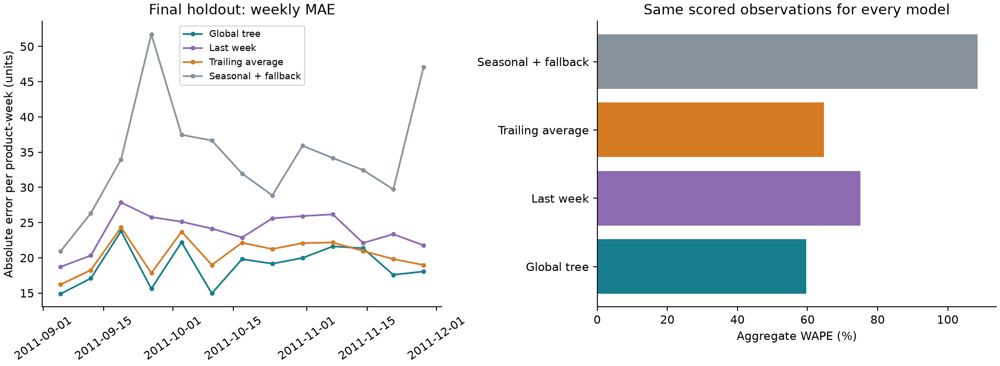
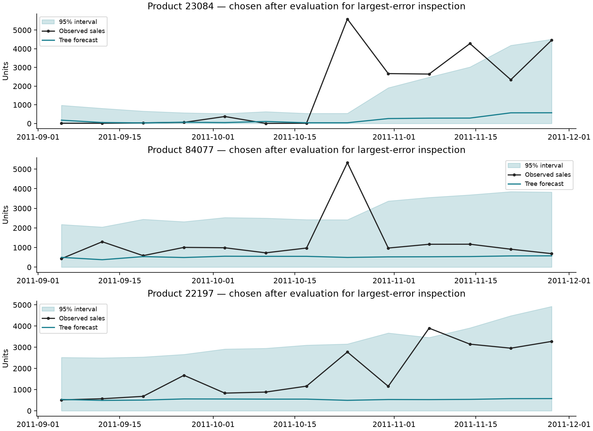

# Final frozen evaluation — 2026-10-24

The selected global tree improved pooled point accuracy over all three baselines on the final chronological holdout. Its residual intervals undercovered, particularly at the 80% nominal level and for medium-scale products. The evaluation is complete: this holdout is now exposed. Any subsequent model, feature, interval or eligibility changes must be labeled exploratory, not presented as another untouched final test.

The procedure was recorded in [the immutable declaration](FINAL_EVALUATION.md), [freeze manifest](final_freeze.json) and [historical calibration](interval_calibration.json) before `artifacts/uci/final/STARTED.json` was created. Checks confirm the timestamp order and hashes. No hyperparameter or interval-method changes were made after opening holdout outcomes. The 13 Monday origins were 2011-09-05–2011-11-28; each target is the following Monday-to-Sunday week. The medium tree was retrained weekly using only earlier closed weeks. Earlier holdout observations entered later training as explicitly frozen; interval quantiles never updated from holdout errors.

## Point accuracy and forecast coverage

All four methods scored the same **59,395 product-week rows**, covering **4,693 products** and **1,884,478 observed positive units**. There were 60,389 candidate rows: forecast/scoring coverage was **98.3540%**. Exclusions were 237 new-product and 757 short-history rows. No history-eligible row had an unavailable target in this run. All-zero histories were included. Seasonal-naive used the frozen trailing-average fallback on 7,677 scored rows.

| Method | MAE (units) | Aggregate WAPE |
|---|---:|---:|
| Selected global tree | **18.9452** | **59.7114%** |
| Trailing four-week average | 20.5286 | 64.7019% |
| Last observed week | 23.8326 | 75.1158% |
| Seasonal-naive plus fallback | 34.4262 | 108.5046% |

The tree reduced pooled absolute error by approximately **7.71%** relative to the best baseline, trailing-average. It beat that baseline on 12 of 13 weekly MAEs, but lost in the week of 2011-11-14 (21.3613 versus 20.9697). Across products, it lost on 868, tied on 1,508, and won on 2,317 product-level MAEs. Product counts are not volume-weighted and some ties are dominated by inactive/zero series; they do not replace the pooled comparison.

Aggregate WAPE divides total absolute error by total actual units; it is not a mean of product WAPEs. Zero-denominator product metrics are blank/null, with MAE retained. The 403 all-zero-history scored rows had zero actual and predicted sales, MAE zero, and undefined WAPE.



## Interval accuracy and width

Calibration used **163,986 out-of-sample development residuals**, not fitted training errors. The fixed normalized-error quantiles were 0.6408995149 (80%) and 2.6666666667 (95%). Each was multiplied by `max(1, prior mean13)` at the forecast origin. The lower endpoint is clipped at zero; endpoints are not rounded. Global pooling supplies a fallback for sparse product histories, with available prior weeks used for the mean when fewer than 13 exist.

| Nominal level | Empirical coverage | Mean width (units) | Median width | Mean interval score |
|---|---:|---:|---:|---:|
| 80% | **75.4542%** | 32.0983 | 1.3804 | 121.6201 |
| 95% | **94.1796%** | 92.9250 | 4.9231 | 216.1940 |

The 80% method missed its nominal level by 4.55 percentage points; the 95% method missed by 0.82 points. These are empirical observations, not statistically certified coverage guarantees. Time dependence, cross-product correlation, changing distributions, refitting and reuse of development folds for configuration selection weaken exchangeability-based guarantees. Near-95% aggregate coverage also hides materially worse conditional coverage.

| Prior observed-history segment | Scored rows | Tree MAE | Tree WAPE | 80% coverage | 95% coverage |
|---|---:|---:|---:|---:|---:|
| 4–12 weeks | 1,882 | 40.4711 | 54.8454% | 69.8193% | 95.3773% |
| 13–51 weeks | 5,795 | 37.7667 | 55.7936% | 64.6764% | 93.6324% |
| 52+ weeks | 51,718 | 16.0529 | 61.3463% | 76.8669% | 94.1974% |

New products and 1–3-week histories have zero forecast coverage by the predeclared eligibility rule; the results make no accuracy claim for them. Eligible history groups each had 100% target availability in this run. Full coverage/exclusion breakdowns by history, scale and activity are in [metrics.json](reports/final/metrics.json).

| Historical scale (units) | Scored rows | Tree MAE | 80% coverage | 95% coverage | Mean 95% width |
|---|---:|---:|---:|---:|---:|
| ≤5 | 35,532 | 1.3099 | 84.3972% | 94.6555% | 3.9459 |
| >5–25 | 10,113 | 15.4534 | **55.3940%** | **90.3392%** | 43.2667 |
| >25 | 13,750 | 67.0855 | 67.0982% | 95.7745% | 359.3832 |

Normalization helps widths reflect scale, but pooling does not equalize coverage across groups. The medium-scale group is particularly poorly served. Wide high-scale intervals and very narrow low-scale intervals explain the large difference between overall mean and median widths. Any group-specific or adaptive recalibration motivated by these findings would be a new exploratory method; it was not performed here.


## Error analysis

The largest error was product **23084**, week **2011-10-24**: actual 5,593 units, tree forecast 38.6692, 95% upper bound 544.3102. Product 84077 in the same week had 5,328 actual units against 494.6593 predicted and a 95% upper bound of 2,420.6080. The model lagged large positive sales changes; the historical scale widened only after those weeks had closed. This is descriptive evidence of spike/level-change misses, not proof of promotions, unmet demand, stockouts or inventory effects.

Of 3,457 misses of the 95% interval, **3,446 were above the upper bound** and 11 below the lower bound. Symmetric absolute-error intervals around an MAE-oriented predictor plus zero clipping do not provide balanced tail errors. The direction of misses and scale-segment undercoverage are more informative than aggregate coverage alone. Top 20 errors and three post-hoc selected product plots are saved; choosing these examples is error analysis, not model tuning.



Holdout MAE (18.9452) is higher than development MAE (13.7679), while WAPE is lower (59.71% versus 71.11%). The periods have different sales volume and composition, so these changes should not be treated as a single measure of improvement or deterioration. No significance or business-impact claim is made from this one dependent holdout window.

## Runtime and measurement conditions

Wall-clock `perf_counter` measurements on this macOS arm64 laptop, Python 3.14.0, scikit-learn 1.9.1, sequential folds, two model threads, no hyperparameter search during holdout:

| Component across 13 origins | Seconds |
|---|---:|
| Shared historical feature creation | 5.1837 |
| Tree refits | 19.4463 |
| Tree prediction calls | 0.0937 |
| All three baseline forecasts including panel preparation | 0.4723 |
| Complete evaluation including loading/report generation | 27.5129 |

The whole-run time excludes development calibration and plot generation. Feature creation is reported separately from inference; baseline time includes its panel preparation, so these are measured implementation scopes rather than a universal speed ranking. Per-origin runtime and training-row counts are in [runtime.csv](reports/final/runtime.csv). No fold failed, and no difficult model/fold was skipped.

## Saved artifacts and verification

`artifacts/uci/final/` contains predictions with actuals, all four point forecasts, fixed 80%/95% bounds, origin timestamps/scales/segments; eligibility audit; runtime; point and interval metrics by product, history, scale, activity and origin; largest errors; and STARTED/COMPLETED provenance markers. Readable aggregates and plots are in `reports/final/`. Raw data and large generated artifacts remain ignored by Git.

```sh
.venv/bin/python -W error -m unittest discover -s tests -v
.venv/bin/retail-forecast --config config.uci.toml freeze-final
.venv/bin/retail-forecast --config config.uci.toml evaluate-final
.venv/bin/python -W error scripts/verify_final.py
.venv/bin/python scripts/plot_final.py
```

The freeze and evaluation commands have already been executed. They deliberately refuse to overwrite the existing freeze/run. Verification and plotting read saved artifacts and may be rerun. Future exploratory comparisons must preserve these records and disclose holdout reuse.

Twenty-six tests passed, covering known quantiles, scale invariance, clipping, coverage/width/interval-score calculations, historical segments, origin-time baseline parity, rejection of current/future history and existing causal-feature tests. Saved-data checks verified the freeze preceded the start marker, identical scored keys, pooled metric calculations, and every interval against the unchanged historical quantiles. Plots were visually inspected.

Data limitations remain: extraction completeness and local timezone are assumptions; duplicate lines are retained; returns/adjustments are separate; observed sales are not unconstrained demand. Monitoring, dashboard and release packaging remain future work.
