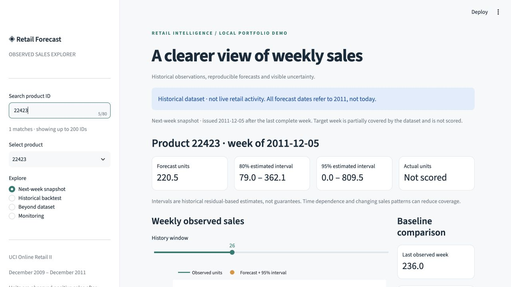
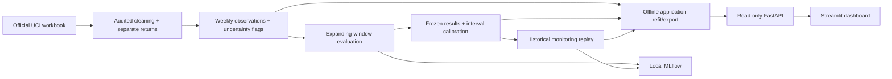
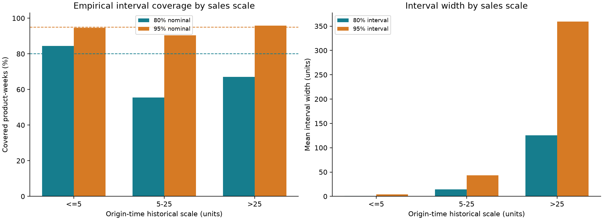

# Retail Forecast

[](https://github.com/thilankathushan/retail-forecast/actions/workflows/ci.yml)

Public source repository with a self-contained Streamlit Community Cloud deployment mode. Historical data only; cloud deployment status must be verified separately.

**One-week-ahead observed product sales, with reproducible evaluation and visible uncertainty.**

Retail Forecast is an ML engineering portfolio project by Thilanka Thushan. It turns UCI Online Retail II transactions into audited weekly series, compares simple baselines with a global scikit-learn tree, and serves saved forecasts through FastAPI and Streamlit. Local MLflow and a historical replay make data versions, errors and monitoring decisions inspectable.

**This is historical data, not today's retail activity. Transactions establish observed sales—not true demand, inventory availability or stockouts.** The app makes no purchasing or inventory recommendations.



[Case study](CASE_STUDY.md) · [Data card](DATA_CARD.md) · [Model card](MODEL_CARD.md) · [Reproduction guide](REPRODUCING.md) · [Release checklist](RELEASE_CHECKLIST.md) · [Demo script](DEMO_SCRIPT.md)

## What was measured

The frozen final evaluation covers 13 weekly origins, September 5–November 28, 2011. All models score the same **59,395 product-weeks** across 4,693 products, covering **98.354%** of candidates.

| Model | MAE, units | Aggregate WAPE |
|---|---:|---:|
| Global tree | **18.9452** | **59.7114%** |
| Trailing four-week mean | 20.5286 | 64.7019% |
| Last observed week | 23.8326 | 75.1158% |
| Seasonal naive + fallback | 34.4262 | 108.5046% |

The tree reduced pooled absolute error about **7.71%** versus the trailing mean. It did not win everywhere: it lost on one weekly MAE and 868 product MAEs. New/sparse histories account for 994 excluded candidate rows; eligible all-zero histories stay in the comparison. WAPE pools absolute errors and actual units; it is never an average of product WAPEs. A zero denominator produces null WAPE.

| Nominal interval | Measured coverage | Mean width, units |
|---|---:|---:|
| 80% | **75.4542%** | 32.0983 |
| 95% | **94.1796%** | 92.9250 |

The 80% intervals undercovered, especially for medium-scale products (55.39% coverage). Large upward spikes remain a failure mode. Intervals are estimates, not guarantees under dependence or distribution shifts. These limitations were retained rather than tuned away using final outcomes. [Full results, segments and error analysis](FINAL_RESULTS.md).

Final execution took 27.51 seconds on macOS arm64/Python 3.14.0/scikit-learn 1.9.1 with two threads, including 19.45 seconds of refitting over 13 sequential origins. This is a laptop experiment timing, not an API throughput claim. **The holdout is exposed; future model changes are exploratory.**

## Architecture



The core, app and optional tracking environments are isolated. Feature generation is shared between training and inference. The API validates and caches a saved JSON bundle; requests never retrain or deserialize model binaries. SQLite monitoring keys prevent duplicate forecasts and defer error measurement until actuals are available.

## Quickstart

Clone the standalone repository first:

```sh
git clone https://github.com/thilankathushan/retail-forecast.git
cd retail-forecast
```

Run from the project root with Python 3.14 (verified locally on 3.14.0). Installation requires package-index access; fixture tests run offline afterward.

```sh
python3 -m venv .venv
.venv/bin/python -m pip install -c requirements-lock.txt -e .
python3 -m venv .venv-app
.venv-app/bin/python -m pip install -c requirements-app-lock.txt -r requirements-app.txt
.venv/bin/python -W error -m unittest discover -s tests -v
.venv-app/bin/python -W error -m unittest discover -s app_tests -v
```

These tests need no UCI download. The synthetic fixture is invented software-test data, not benchmark evidence. Exact pins describe the verified environments, not universal platform compatibility. The core package declares broader compatibility, but frozen reproduction requires its recorded numerical versions.

**To use real data:** follow [the raw-data-to-demo route](REPRODUCING.md), which produces `artifacts/uci/application/bundle.json` and its adjacent `manifest.json`. A fresh checkout does not contain raw data, models or the large serving bundle. If the preceding milestones are already complete, only these commands are needed to export/verify the app:

```sh
.venv/bin/python scripts/build_app_bundle.py
.venv/bin/python scripts/verify_application.py
```

Start the API in one terminal:

```sh
.venv-app/bin/python -m uvicorn retail_forecast.api:app --host 127.0.0.1 --port 8000
```

Start the dashboard in another:

```sh
.venv-app/bin/python -m streamlit run dashboard.py --server.address 127.0.0.1 --server.port 8501
```

Open [the dashboard](http://127.0.0.1:8501) and [API documentation](http://127.0.0.1:8000/docs). Search product ID **22423**. Stop each process with Ctrl-C. No recurring job or notification service is installed.

```sh
.venv-app/bin/python scripts/smoke_application.py
```

## Data preparation

[UCI Online Retail II](https://archive.ics.uci.edu/dataset/502/online+retail+ii), Chen, D. (2012), DOI [10.24432/C5CG6D](https://doi.org/10.24432/C5CG6D), **CC BY 4.0**. The official workbook lists 43.5 MB; the retrieved ZIP is 45,622,418 bytes. [Recorded source URL, retrieval date and hashes](reports/uci_source.json).

```sh
.venv/bin/retail-forecast download --raw-dir data/raw
.venv/bin/retail-forecast import-uci --raw-dir data/raw
.venv/bin/retail-forecast --config config.uci.toml prepare \
  --input data/raw/transactions.csv --coverage-start 2009-12-01 \
  --coverage-end 2011-12-09 --assume-complete --min-history-weeks 4
.venv/bin/python scripts/verify_uci.py
```

Both sheets are used: **1,067,371 rows**, **1,037,021 accepted positive-sale lines**, **21,741 negative-unit return/adjustment candidates**, **4,725 products**. Missing customer IDs do not discard valid sales. Repeated rows are retained and audited because there is no reliable line ID proving error. Cancellation, non-product, timestamp, quantity and price rules are documented in the [data contract](DATA_CONTRACT.md), [dictionary](DATA_DICTIONARY.md) and [cleaning report](reports/uci_cleaning.json).

Weeks run Monday 00:00 to the next Monday, end-exclusive, in assumed Europe/London wall-clock time. Issue time follows the previous week's closure and availability. The source timezone and delivery times are not independently verified. `--assume-complete` permits absent transactions in complete weeks to mean zero observed sales; without that assumption targets remain unknown. Missing/partial weeks are never silently zero-filled. Products enter at first accepted sale, with no future-sales or survival filter.

## Training, backtesting and forecasting

Dates were chosen from coverage before measuring performance: 52 initial weeks; 39 development origins (2010-12-06–2011-08-29); 13 final origins (2011-09-05–2011-11-28). Training expands chronologically. Four consecutive prior observed weeks are required, independently at every origin. No random train/test split is used.

```sh
.venv/bin/retail-forecast --config config.uci.toml backtest
.venv/bin/retail-forecast --config config.uci.toml tree-backtest
.venv/bin/retail-forecast --config config.uci.toml tree-forecast --issue-week 2011-08-29
```

The global histogram tree uses lagged sales, shifted rolling statistics, calendar features and past history/activity. No target-week prices/quantities or future catalog knowledge are inputs. Two bounded configurations were compared; medium (60 rounds, 15 leaves) achieved development MAE 13.7679/WAPE 71.1071%, versus trailing mean 17.5423/90.6005%. Selection used development results, so they are not an independent generalization claim. [Model details](TREE_MODEL.md).

Intervals use OOS development residuals divided by `max(1, prior 13-week mean)`, with fixed 80%/95% quantiles. Nothing is calibrated from fitted residuals or final outcomes. [Frozen protocol](EVALUATION_PROTOCOL.md) and [model card](MODEL_CARD.md).

Final evaluation is guarded against overwrite. On a fresh checkout, reproduce using the committed freeze as described in [REPRODUCING.md](REPRODUCING.md); do not run `freeze-final` again or delete completed outputs. On this existing workspace, verify only:

```sh
.venv/bin/python scripts/verify_final.py
.venv/bin/python scripts/verify_application.py
```

`train`/`forecast` are foundation persistence utilities; `tree-forecast` reloads the development model. The app's offline exporter separately refits the selected configuration before 2011-12-05 and saves **4,703** unscored dataset-edge forecasts. That post-evaluation refit makes no new performance claim.

## Dashboard and API

Four views separate evidence clearly:

- **Next-week snapshot:** issued December 5, 2011 for December 5–11; source ends December 9, so target actual is unknown/unscored.
- **Historical backtest:** choose a frozen holdout origin; actual and forecast are separate, and chart history is cut off before that origin.
- **Beyond dataset:** December 12 onward is withheld because the immediately preceding week is incomplete. This is not a forecast for today.
- **Monitoring:** observed UCI outcomes with simulated delivery timing, interval coverage and event history.

Search is a literal case-insensitive product-ID substring match, capped at 200 displayed matches; catalog browsing is retrospective. Loading, missing artifacts, empty searches, short histories and unavailable forecasts have explicit states. Forecast provenance includes issue time, target week, training cutoff, model version and data version. No inventory/purchasing recommendations are inferred.

| Endpoint | Purpose |
|---|---|
| `/health` | Process liveness |
| `/meta` | Artifact readiness, coverage and provenance |
| `/products?q=22423&limit=50` | Bounded literal search |
| `/history?product_id=22423` | Observations with nulls/status flags |
| `/forecast?product_id=22423&mode=dataset_edge` | Saved next-week snapshot |
| `/forecast?product_id=22423&mode=historical&target_week=2011-11-28` | Archived evaluated prediction |
| `/forecast?product_id=22423&mode=beyond_dataset` | Explicit unavailable reason |
| `/monitoring` | Simulated real-data replay summaries/events |

Pydantic validates finite nonnegative forecasts, interval ordering and timestamps. Invalid requests return 422; unknown products/origins 404; missing/malformed/hash-mismatched bundles an actionable 503. The API caches the ~59 MiB bundle in one worker; restart after rebuilding. Dashboard responses cache for 60 seconds. `.env.example` documents Compose settings and explicit shell overrides; no secrets are needed. This is a local demo, not an authenticated public service.

## Monitoring and experiment tracking

```sh
.venv/bin/retail-forecast --config config.uci.toml monitor-replay --scenario real
.venv/bin/retail-forecast --config config.uci.toml monitor-replay --scenario missing_columns
.venv/bin/python scripts/verify_monitoring.py
```

The verifier expects all seven synthetic scenarios from the reproduction guide. Missing columns, dropped products, invalid quantities, late arrivals, sales and activity shifts use fictional data kept separate from real findings. Error and coverage are calculated only after target closure and valid delivery. Thresholds are explicit operational examples, not final-holdout tuning; distribution changes invite investigation, not an automatic declaration of model failure.

Optional MLflow uses `.venv-tracking` and local SQLite/artifacts. It logs saved evaluation configurations, data hashes, cutoffs, parameters, metrics and artifacts with request fingerprints that reuse runs on retry. See [MONITORING.md](MONITORING.md) for exact setup, commands, limitations and a batch scheduling example that is **not installed**.

## Docker, CI and release status

The application-only image contains no raw data or model binaries. Mount the generated application directory read-only:

```sh
docker compose config --quiet
# Alternate ports avoid conflicting with native servers.
RETAIL_API_PORT=8001 RETAIL_DASHBOARD_PORT=8502 docker compose up --build -d --wait
.venv-app/bin/python scripts/smoke_application.py --api http://127.0.0.1:8001 --dashboard http://127.0.0.1:8502
docker compose down
```

The image built locally, both containers became healthy and the real-data HTTP smoke passed on ports 8001/8502. See [artifact setup and container details](REPRODUCING.md). Containers run non-root with read-only roots; published ports bind localhost. Healthchecks wait for artifact readiness. The build context is allowlisted. Public deployment is out of scope.

Fixture-only GitHub Actions configuration is included under `.github/workflows/ci.yml`. Project 3 is a standalone repository, so the workflow is at its repository root; no parent-repository workflow was added. Local tests and recorded checks are distinguished from hosted CI/container verification in [RELEASE_CHECKLIST.md](RELEASE_CHECKLIST.md). Hosted run status is recorded in the release checklist.

[Release-file audit](reports/release/audit.json) covers candidate files, possible secret patterns, generated/private paths and large binaries. This is not a proof of no secrets or a vulnerability audit. Dataset attribution is documented; original code is licensed under [MIT](LICENSE). See [third-party notices](THIRD_PARTY_NOTICES.md).

## Screenshots and supporting documents

Actual captures: [historical chart](reports/application/historical-chart.png), [monitoring](reports/application/monitoring.png), [beyond-dataset warning](reports/application/beyond-dataset.png), [empty-search recovery](reports/application/empty-search.png). No synthetic incident is presented as a real-data finding.



[Case study](CASE_STUDY.md) explains engineering tradeoffs and failures; [demo script](DEMO_SCRIPT.md) provides a two-minute recording guide. [PROGRESS.md](PROGRESS.md) records milestones and verification. Official implementation references: [FastAPI tests](https://fastapi.tiangolo.com/tutorial/testing/), [Starlette test client](https://www.starlette.io/testclient/), [Streamlit charts](https://docs.streamlit.io/develop/api-reference/charts/st.plotly_chart), [Docker Compose](https://docs.docker.com/reference/compose-file/services/).

## Streamlit Community Cloud

Deploy repository `thilankathushan/retail-forecast`, branch `main`, entrypoint `dashboard.py`. Select Python 3.13 in Advanced settings. Root `requirements.txt` installs the dashboard dependencies. No secrets, external API or separate Render service are required. Leave `RETAIL_API_URL` unset for the standalone mode; set it only when intentionally using the FastAPI backend.

The default dashboard reads selected products from the hash-verified, approximately 8 MB `demo/observed-sales.zip`. It contains attributed derived historical observations and forecasts, not customer IDs, raw transactions or model binaries. See [demo provenance](demo/README.md). This deployment export does not change model predictions or rerun the holdout.

For an existing failed cloud deployment, allow the GitHub update to rebuild dependencies; if it does not, use **Manage app → Reboot app**. No dependency names should be entered as secrets. Check product 22423, historical week 2011-11-28, Monitoring and Beyond dataset after deployment. Community Cloud may sleep and has resource limits; this is a portfolio demo, not production monitoring.
